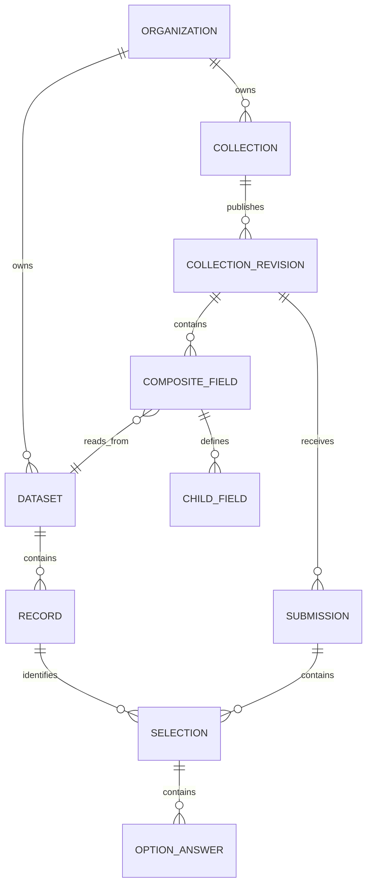

# Dataset-backed item cards: design proposal

Status: proposed design; not yet implemented. Applies to organizations generally, not only restaurants.

## Core model

A dataset is a reusable collection of records. An item card is a presentation of a record, with an optional nested group of questions for each selection. A form contains ordinary fields and composite fields; a composite field contains fields and can repeat. Share field types and validation through composition, not a separate Django form subclass per industry.

Example: the organization owns a Drinks dataset with Dew, Sprite, and Pepsi records. A form has Name, Email, and a Drinks item-card field. For each selected drink, ask Quantity 1–10 and any configured options. A form submission stores selected record IDs and the answers specific to each selection; it does not change the Drinks dataset merely because a customer placed an order.

This is a logical target, not a claim that every named entity is a database table. The existing revision schema and JSON responses can represent child definitions and answers; transactional catalog/order records remain typed where needed.

## Data boundaries

- Record attributes are maintained by the organization: name, description, price, availability, and image where supported.
- Child question definitions describe allowed input: quantity, size, spice, notes, or rating. A reusable item-type template may supply defaults; explicit per-record overrides can narrow or add options. A collection can select the template and add collection-specific questions. Define precedence as template, then item override, then collection-specific additions; reject duplicate field IDs instead of silently overriding them.
- Selection answers are supplied by the respondent for that submission. Two selections of one item with different options remain separate lines; identical selections may combine quantities only after explicitly matching all options.
- Item price/availability/stock, when enabled, are server-authoritative. Snapshot the record label, price, option labels, and any price adjustments at submission. Client-supplied prices do not set totals.
- Feedback ratings normally live in a feedback collection, not as an order attribute. They can refer to an item record.

## Proposed authoring experience

1. Organization creates an Items library backed by a dataset and defines its record fields; importing the existing catalog is an explicit, reviewable operation.
2. It defines reusable selection questions such as quantity and spice using the existing field vocabulary. Price/stock behavior is optional, not required for every item.
3. Form creator adds an Item cards question, picks an authorized dataset, maps display fields, and previews per-selection questions. A normal Group question reuses the same child-field mechanism without a dataset.
4. Respondent selects records and supplies child answers. Server validates the published collection version, permitted public projection, current availability, child answers, and any enabled transaction rules before committing.

## Architecture and compatibility

The current application has two independent sources: `Catalog`/`CatalogItem` feed `item_cards`, while `Dataset`/`Record` feed record references and mapped submissions. The existing typed `ItemSelection`/`SelectionLine` records retain price and name snapshots. Nested per-item questions and dataset-backed item cards are not implemented.

Introduce a common composite field definition and dataset-backed item-card source as an additional source adapter. Keep legacy catalog fields, IDs, URLs, selections, totals, and historical revisions readable; do not silently convert or reprice them. Offer a previewed, idempotent catalog-to-dataset import with explicit mapping and recorded source IDs. New forms can select the new source; existing forms remain on their current source until explicitly converted. Avoid editing published revisions: conversion publishes a new revision, preserving historical responses.

Card configuration must whitelist public fields. A public card must not reveal the entire dataset, private fields, grants, or management APIs; an authenticated member's lookup permission must not become a blanket public grant. Validate tenant ownership and configured card projection on the server.

Do not treat arbitrary JSON as a financial or inventory ledger. Use typed commercial/inventory capability records with transactions and immutable snapshots when those capabilities are enabled. Dataset records supply reusable reference information; dedicated domain rules enforce financial correctness and resource availability.

## Acceptance checks

- One field with Dew/Sprite/Pepsi supports quantity 1–10 and separate child answers per selection; reject missing required answers and invalid options.
- Same item selected twice with different choices remains two lines; an inactive or cross-organization record is rejected without a partial submission.
- Public cards show only explicitly published fields; private dataset APIs and confidential fields remain inaccessible.
- Changing item name, price, or option labels later does not alter historic submission snapshots.
- Nested group IDs are stable, conditional questions validate correctly, schema revisions preserve old answers, and repeats have limits.
- Existing catalog forms and historical selections remain readable after upgrade; explicit imports/conversions are repeatable and never duplicate items.
- Concurrent quota/stock checks, where enabled, remain atomic on the actual SQLite backend. Shared datasets do not automatically authorize writes.
- A survey, an equipment request, and a cafe menu can all use groups/cards without restaurant-specific requirements.

## References

- [ODK form logic](https://docs.getodk.org/form-logic/) and [ODK entities](https://docs.getodk.org/entities-intro/) show grouped/repeated capture and reusable records.
- [Odoo product variants](https://www.odoo.com/documentation/19.0/applications/sales/sales/products_prices/products/variants.html) distinguishes tracked variants from informational options.
- [Shopify line-item properties](https://help.shopify.com/en/manual/fulfillment/setup/notifications/email-variables-reference) illustrates per-purchase custom information.
- [JSON Schema array of objects](https://tour.json-schema.org/content/01-Getting-Started/06-Array-of-Objects) illustrates a repeated group of structured answers.
