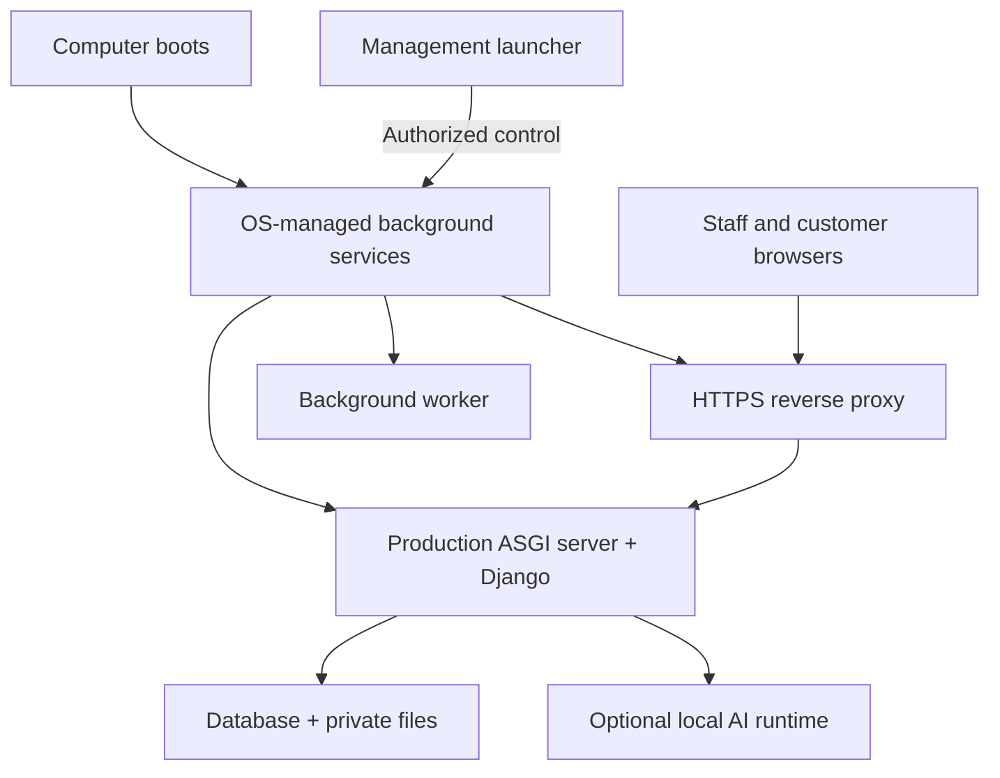

# Installed Organization Server — Nontechnical User Experience

Updated: 23 October 2026. Design specification; no installer or startup service has been built or registered by this document.

Immediate prototype decision: use the repository's `Start OrgForms.bat` and
`start_orgforms.py` for manual double-click startup on a prepared Windows
computer. They open the default browser after readiness and keep a visible
server window. They are loopback-only development launchers, not the production
installer/service specified below. See the Windows setup section in README.md.

## Product decision

Distribute an installed **Organization Server** application. It hosts the universal Django collection engine on the organization's computer. Its staff/customer interface remains a browser-based web app; customer phones do not install Python or the server package. Cafes, event organizers, and other organizations use the same installer with different collections and capabilities.

The installer bundles the supported Python runtime, pinned dependencies, Django application, static assets, production server, service configuration, and management launcher. Owners do not install Python, activate environments, open terminals, or run `manage.py runserver`.

## Owner journey

1. Download the signed installer for the computer's operating system/architecture.
2. Complete one installation approval to register background services and necessary restricted firewall rules.
3. Open the first-run wizard on the server computer: create owner credentials, name the organization, select enabled capabilities, and configure the data/backup location.
4. Confirm automatic start at system boot. The service runs independently of the launcher and browser.
5. Verify local access from a phone on the intended Wi-Fi and print/copy a collection QR code.
6. Optionally install selected speech/LLM models. Show download size and disk/memory requirements; AI installation is not required for basic collection.
7. Use the normal workspace in the browser. An installed shortcut opens it; the management launcher shows service/connection status if the server is unavailable.

Launcher controls: Open workspace, Server status, Start/Stop/Restart, Local connection link/QR, Backup/Restore, Updates, Internet access, and Export diagnostics. Distinguish collection-server, AI, network, backup, and certificate health. A failed AI service must not make a healthy collection server look offline.

Closing the launcher, tray/menu interface, terminal, or browser does not stop the service. Stopping/restarting requires an authorized local operator and a warning about active work. A local control channel is restricted to authorized OS users; management commands are not unauthenticated LAN web endpoints.

## Runtime architecture

- Use Django's existing ASGI entrypoint with a production ASGI server; Uvicorn is the proposed default, subject to packaging/streaming verification on supported systems. Do not use development reload mode.
- Use Caddy as the HTTPS reverse proxy and static-asset server. Bind the application server to loopback. Serve uploads only through permission-checked application endpoints, not a public media-directory mapping.
- Register application/proxy/worker processes under native service supervision with bounded crash-restart backoff and graceful shutdown. Start optional AI separately so AI initialization cannot block ordinary collection readiness.
- Windows uses a Windows Service, macOS uses a launchd LaunchDaemon, and Linux uses systemd. The optional user-visible launcher starts on login; the server starts on boot. Do not confuse login startup with boot startup.
- Run normal processes with restricted service identities. Installation elevation does not mean the Django process should run as administrator/root. Give the proxy only the privileges needed for its listeners and certificate storage.
- Package separate builds per OS/architecture. PyInstaller one-folder bundles are the initial packaging approach; include Django templates/static data and hidden imports explicitly. Use native installers around those bundles. Test startup on a clean machine without Python installed.
- Choose Windows as the first nontechnical pilot installer unless pilot device inventory indicates otherwise. Maintain macOS developer support; verify each claimed production OS separately before distribution.

## Persistent state and lifecycle

- Separate replaceable application files from database, private media, secrets, backups, certificates, model downloads, and logs. Use an OS-appropriate protected application-data directory, not the installation bundle or user's Downloads folder.
- Generate per-installation secrets/identity. Restrict first-run account setup to a local one-time authenticated bootstrap flow; do not leave an unclaimed owner endpoint open to the network.
- Ensure one writer/service instance per data directory. Detect an existing instance and port conflict instead of starting a competing server.
- Gate schema migrations on a controlled application upgrade. Back up first, stop writers, migrate once, verify readiness, and resume service. Do not rerun destructive recovery or imports on every boot.
- Preserve data on upgrades and default uninstall. Removing business data is a separate explicit destructive choice.
- Apply verified updates in a maintenance window. Code rollback must respect schema compatibility; restarting old code against an incompatible migrated database is not recovery.
- Rotate logs, display disk-space/backup warnings, and exclude credentials, answer contents, and personal documents from routine diagnostic bundles.
- Use a service health endpoint that distinguishes liveness and readiness without revealing sensitive configuration. Failed writes must not receive successful submission receipts.

## Local networking and HTTPS

The wizard detects the selected network interface and confirms phone reachability. Show a clear local address/QR and diagnose firewall blocks, guest-network client isolation, and changed network addresses. Use a stable hostname and router DHCP reservation where available rather than promising a detected IP never changes.

Trusted HTTPS is required for supported microphone/camera behavior. A private certificate automatically trusted on the server is not automatically trusted on customer phones. Prefer a managed organization hostname with publicly trusted certificates and local DNS resolution; provision certificates using DNS validation for LAN-only installations. Verify DNS behavior on actual phones/routers. Where this cannot be configured, show a setup requirement and provide assisted setup rather than bypassing browser trust warnings or silently downgrading voice capture.

## Optional internet access

Keep internet access off by default. Enabling it is a separate owner-authorized wizard, not an automatic consequence of installation or a software update.

Direct public-IP mode:

1. Confirm public reachability with a real external connection test. Detect or explain CGNAT/double NAT, ISP restrictions, and address changes; merely showing a public IP from a lookup does not prove inbound access.
2. Configure a stable organization domain, with dynamic DNS when necessary, and a router reservation for the local server.
3. Guide the owner or installer through forwarding only the required HTTPS endpoint to the reverse proxy. Avoid automatic router-wide UPnP exposure.
4. Provision/renew the trusted certificate and validate allowed hosts, trusted proxy settings, secure sessions, and public collection access policies.
5. Test from outside the Wi-Fi. Show Internet access as active only after that succeeds.

Offer an outbound authenticated relay/tunnel as a later supported alternative where forwarding is unavailable. Explain its external-service dependency. Never expose the Django development port, database port, local AI port, bootstrap endpoint, or service-management channel directly.

Public access does not grant permission to submit to every collection. Retain LAN-only/table-session requirements for on-site ordering when configured, while separately allowing a public survey. Apply the network restriction at the trusted listener/proxy boundary; do not trust a client-supplied IP header as evidence of LAN origin.

Router setup cannot be guaranteed to be one-click across arbitrary hardware. Keep the owner's experience simple, but make failed prerequisites visible and offer assisted setup. Public-IP hosting does not make the computer redundant or remove its power/network dependency.

## Availability expectations

Automatic startup means recovery after an ordinary reboot once the OS can run the service. It cannot serve requests while the computer is off, suspended, disconnected, waiting for an encrypted-disk unlock, or affected by a power outage.

The setup wizard explains power/sleep settings and offers an explicit choice to keep the machine awake while plugged in. Do not promise laptop-lid behavior is identical across operating systems. Recheck service/network readiness after resume. Recommend a plugged-in dedicated machine and optional UPS for organizations needing continuous availability; a small dedicated PC is an upgrade path, not a prerequisite for a demo.

If the owner needs public collection while their computer is off, offer hosted workspace mode rather than implying a startup service solves that requirement.

## Implementation and acceptance

1. Build and verify a foreground production-runtime bundle on the development platform.
2. Add protected configuration/data paths, bootstrap, migrations, health checks, and the launcher.
3. Add native boot-service installers; validate the first pilot OS on a clean machine.
4. Add LAN/TLS diagnostics and backup/restore before unattended pilot operation.
5. Add signed distribution/update handling and only then optional public-access setup.

Verify: no Python prerequisite; reboot without login; launcher/browser close; process crash/restart; bounded failure loops; disk full; pending upgrade; duplicate instance; Wi-Fi/IP change; sleep/resume; graceful shutdown; AI unavailable; private uploads; preserved data after upgrade/uninstall; restored backups; and rejected unauthorized service controls. Public access requires external testing, TLS renewal, intended audience enforcement, and confirmed private model/database endpoints.

Sources: [Django deployment interfaces and runserver limitations](https://docs.djangoproject.com/en/5.2/howto/deployment/), [Windows Services](https://learn.microsoft.com/en-us/windows/win32/services/services), [launchd agents/daemons](https://developer.apple.com/library/archive/documentation/MacOSX/Conceptual/BPSystemStartup/Chapters/CreatingLaunchdJobs.html), [systemd services](https://www.freedesktop.org/software/systemd/man/latest/systemd.service.html), [PyInstaller bundles and OS-specific builds](https://pyinstaller.org/en/stable/operating-mode.html), and [Caddy HTTPS and client trust](https://caddyserver.com/docs/automatic-https).
