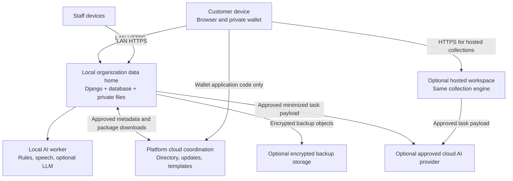

# Local and Cloud Architecture

Updated: 23 October 2026. Proposed design, not a deployed service. Complements [Universal Platform Architecture v3](universal-platform-architecture-v3.md).

Implementation update, 25 October 2026: shared capture has immutable definitions, response history, retry receipts, and response caps. Organization-scoped datasets, schema/record revisions, independent grants and explicit collection mappings now use that same authoritative SQLite data home. Mapped capture commits the response and record atomically; it does not create a second store, automatic cloud export or database replication. This does not provision the production runtime or cloud services below. See [implementation status](implementation-status.md).

Nontechnical installation, automatic boot startup, the management launcher, and optional public-IP hosting are specified in [Installed Organization Server](installed-server-experience.md).

## 1. Recommendation

Keep the platform's collection engine independent of hosting. Support a local organization server first, an optional hosted workspace later, and small cloud coordination services that do not need to store private operational data.

Make four independent boundaries explicit:

1. Customer device: private reusable profile, personal files, drafts, and user-controlled backups.
2. Organization data home: authoritative collection definitions, submissions, datasets, permissions, workflows, stock, and financial records.
3. Platform cloud: directory, software/template distribution, installation management, optional backup transport, and platform subscription administration.
4. AI execution: local by default; cloud only for approved tasks and permitted payloads.

Local AI does not require local data hosting; cloud AI does not require moving the organization database to the cloud. Hosting and inference are different configuration decisions.

One organization workspace has one active authoritative data home: `local_server` or `hosted`. For the first prototype, a workspace remains the existing Organization deployment boundary; do not introduce another competing tenant hierarchy. The same core models/APIs operate in either mode. Multiple departments share that data home. Separate installations are separate authorities until an explicit integration is enabled.

## 2. Ownership and placement matrix

| Information or function | Default location | Permitted cloud use |
|---|---|---|
| Customer reusable profile and unshared personal files | Customer device vault | Application code hosting only; no profile upload by default |
| Customer profile backup | Encrypted file exported by customer | Customer can choose any storage provider; our platform does not require an account or copy |
| Customer submission drafts | Customer device | Only on explicit draft submission to the owning workspace |
| Submitted answers and attachments | Workspace data home | In hosted mode, or explicit encrypted backup/export from local mode |
| Collection definitions and organization UI configuration | Workspace data home | Only administrator-selected published templates/metadata; private schemas are not automatically public |
| Departments, staff grants, local sessions | Workspace data home | Optional authenticated directory integration later; not a dependency of local runtime |
| Reference datasets, catalog prices, stock, quotas | Workspace data home | Explicit report projections or hosted mode, never independent competing balances |
| Work items, order state, issued bills, payments | Workspace data home | Hosted mode or approved read-only projection; financial writes remain authoritative at the home |
| Minimal public organization listing | Platform cloud, opt-in | Display name, public contact information, capability description, and approved link |
| Installation identity and version | Local installation plus registered cloud metadata | Installation UUID, supported protocol/app version, certificate/registration status; no credentials or raw customer records |
| Generic software/component/template library | Platform cloud plus verified local cache | Distribution and updates; templates contain no live submissions or secrets |
| Platform subscriptions | Platform cloud | Organization's subscription to our software, separate from customer bills generated inside the product |
| Technical diagnostics | Local first | Explicitly enabled diagnostics; no answer text, documents, recordings, or prompts by default |
| Organization backup | Consistent local export, plus independent copy | Optional client-side encrypted object storage; backup transport does not require decrypting business data |
| Public event registration/survey | Selected workspace data home | Hosted mode suits internet-facing work; publishing a link alone does not migrate data |

Submitted data is a deliberate disclosure: a customer may keep their original profile private while the organization legitimately retains the values/files they chose to submit, subject to the collection's disclosed retention policy. Deleting the device copy does not retroactively delete submissions.

## 3. Logical deployment

The diagram shows choices and explicit flows, not automatic replication between local and hosted workspaces. The cloud coordination service cannot directly query organization databases or customer device vaults.

### Local organization mode — implement first

- Organization laptop/desktop is the authoritative server. Phones are clients, not independent database replicas.
- Serve the application, static assets, required fonts/scripts, validation, permissions, and operational reports locally. Normal collection does not require external CDNs or live cloud authentication.
- Use the existing SQLite database for the prototype, private media storage, a production Django server, trusted HTTPS reverse proxy, and a local background worker. Test contention before increasing scale.
- Store staff authentication and grants locally. A cloud admin login is not a substitute for a local staff role. Existing authorized local operation must not require a cloud entitlement call per request.
- Initial access stays LAN-only. Provision trusted HTTPS and test guest Wi-Fi routing on real phones. Initial setup/certificate renewal and new downloads can require internet; runtime collection during an outage must not.
- Keep model and database ports private. Internet-facing remote access is a later enabled feature, not default port forwarding.

### Hosted workspace mode — prepare the boundary, implement later

- Run the same collection and business-rule services with a managed PostgreSQL database and private object storage. Database backend support is an implementation task; the current project rejects non-SQLite backends.
- Suitable for public surveys, distributed events, organizations without an administrator/server, and remote teams.
- Keep organization isolation and dataset/collection permissions identical to local mode. Sensitive collections do not become public merely because they are hosted.
- Hosted records remain authoritative in the hosted workspace. A local view/cache does not silently become a writable replica during an internet outage.
- Browser offline drafts can be added where appropriate. Do not promise authoritative offline stock allocation or bill issuance without an explicit distributed transaction/numbering design.

### Platform cloud coordination — small initial surface

Begin with static application/package hosting, published templates, and optional organization/installation registration. Add paid service management, opt-in listings, backups, and remote reporting as separate capabilities when needed.

Templates are copied/versioned into the local workspace and explicitly mapped to local datasets/resources. Downloading an update must not silently replace an active collection revision. Software updates are signed/verified packages, applied in a maintenance window after a backup; keep application/schema compatibility and rollback procedures explicit.

Billing generated by an organization for its customers belongs in its data home. Our platform's own subscription invoices belong in platform cloud administration. These are different data owners and workflows.

## 4. AI routing

Route by task, data permission, latency budget, and resource availability. Replace the current single preferred-provider setting with a policy evaluated before each task; never treat model size as a promise of performance.

| Task | Default execution | Cloud condition |
|---|---|---|
| Required-field/type checks, permissions, stock/quota arithmetic, financial calculations | Deterministic application code at data home | Not delegated to a model |
| Barcode/QR decoding, formatting, simple extraction | Browser or deterministic local code | Usually unnecessary |
| English/Hindi transcription | Organization local speech worker | Disabled in prototype; later only explicitly approved audio tasks |
| Short text-to-field matching | Local rules, then local model if useful | Task/payload approved, bounded cost |
| Proposing a collection from a description | Local model | Optional stronger model using approved description, without private sample records by default |
| Document extraction | Local extraction first | Explicit document-level permission, allowed provider, size/cost limits |
| Dataset question/summary | Permission-filtered retrieval at data home, local model | Approved selected records/aggregates; never upload the entire database automatically |

Policy fields: task kind, allowed execution destinations, cloud payload categories, organization opt-in, respondent disclosure/permission where applicable, provider, deadline, and budget. Credentials remain server-side. Organization permission cannot override a customer's device-vault sharing decision.

Do not silently use cloud when a local model is slow or fails. Offer retry, queued local processing, manual input, or a clearly disclosed cloud option when permitted. Keep deterministic submission and bill issuance available while AI is unavailable.

Use a bounded persistent local AI job queue, initially one active heavy inference job per machine. Benchmark concurrent speech and LLM tasks on actual 16 GB hardware; serialize or unload models as needed. Do not make every customer request wait behind general chat. Delay optional summaries before slowing capture.

Do not describe JEV/ScaleDown configuration variables as verified local models. Verify the actual endpoint, implementation, data handling, and measured behavior before enabling either adapter.

## 5. Cloud connections, reporting, and future synchronization

### One authority per writable dataset

Do not synchronize live SQLite files through a drive service, and do not implement bidirectional overwrites of stock, invoices, quotas, or permissions. A shared schema does not solve conflicting updates. [CouchDB's conflict documentation](https://docs.couchdb.org/en/stable/replication/conflicts.html) illustrates why independent writable replicas require conflict policies; it is not a recommendation to replace our database with CouchDB.

Future event export uses a transactional outbox at the authoritative data home. Events carry stable event ID, source installation, organization, record identity, record version, and event type. Acknowledgement, retry, and receiver deduplication make delivery repeatable; do not claim exactly-once network delivery. The MVP has no automatic operational-record export.

Read-only cloud reports are optional projections of explicitly selected data. Show last successful synchronization and report freshness. Permissions and field visibility still apply; a reporting replica is not a public copy. Revocation stops exports and invalidates server-side cached access, but cannot recall previously downloaded data.

For several independently hosted outlets, each outlet owns its transactional records. An optional organization-wide cloud dashboard aggregates permitted projections. Stock transfers, shared quotas, and globally coordinated financial numbering require dedicated commands/policies; they are not generic JSON merges.

### Remote access to a local workspace

In a later release, use an administrator-enabled authenticated HTTPS endpoint or outbound relay/tunnel. The local server still authorizes and commits operations. The directory reveals only opted-in public information.

If the local server is unavailable, remote writes are unavailable. Do not tell a survey respondent that a submission succeeded merely because a relay accepted a network request. A separate durable cloud-ingress service could be designed later, but pending receipt is distinct from authoritative acceptance, especially for quotas and stock.

### Moving a workspace's data home

Migration is a controlled operation: stop writes, export database/media and versions consistently, import and validate, switch routing, and retire the old writer. Never leave the old and new installation concurrently authoritative. Preserve private receipt links where feasible through explicit routing/mapping. No automatic local/cloud failover in the prototype.

## 6. Backup, outage behavior, and privacy limits

Back up database and private files as a consistent set with a versioned manifest/checksums. Maintain at least one independent copy. Use client-side encryption before optional cloud upload and keep restore keys under organization control. Test restore before promising recovery. Backup freshness and recovery time must be measured and displayed, not assumed.

The customer wallet has a separate encrypted export/import flow. Platform hosting of the wallet code is not a profile backup. Browser storage can be cleared/evicted, and device-only storage is not inherently more reliable. Encryption protects stored files, but a compromised unlocked device or malicious application code can expose them; do not make absolute claims that a web-app operator is cryptographically incapable of accessing unlocked values.

| Failure | Expected local-mode behavior |
|---|---|
| Internet unavailable | Local forms, staff login, submissions, operational workflows, billing, and installed local AI continue if LAN/server work |
| Platform cloud unavailable | Existing local work continues; new downloads/listings/remote reports pause |
| Local AI unavailable | Touch/type capture, validation, and transactions continue; AI controls show an actionable error |
| Cloud AI unavailable or budget exhausted | No silent provider switch; local/manual path continues |
| Local server/Wi-Fi unavailable | Preserve unsubmitted client draft where feasible; no success acknowledgement; device drafts are not committed orders |
| Server disk full or commit failure | Reject write clearly and alert staff; never return a successful receipt |
| Customer wallet website unavailable | An already installed/cached wallet may work; otherwise use manual entry. Do not promise offline wallet availability on every browser |
| Cloud report delayed | Local records remain current; remote report displays its stale timestamp |

## 7. Current implementation gaps and delivery sequence

Observed in the repository:

- Organization-scoped datasets, immutable schema/record versions, explicit collection mappings and independent dataset read/write/lookup grants are implemented. Granular process/field grants and the full reference workflows remain open.
- SQLite and local media are implemented. A hosted PostgreSQL deployment is not supported by settings yet.
- Local/cloud inference adapters exist, but provider selection is coarse and cloud credentials are installation-level. A shared hosted deployment would need per-tenant secret isolation and task-level export controls.
- `UserPortfolio` and `PersonalDocument` are server-stored models today. They must not be advertised as a customer device vault. Add the independent wallet, provide explicit user-directed export, and do not silently delete/migrate existing documents.
- A remote-classification hook exists; it does not establish data-local processing.
- Cloud directory, verified updates, encrypted remote backups, cross-installation reports, remote relay, and synchronization are proposed capabilities, not existing features.

Delivery order:

1. Make the complete universal capture engine reliable on one local data home, including schema versions, permissions, deterministic validation, and local files; demonstrate survey, internal request, and cafe configurations.
2. Add optional device wallet and task-policy AI controls. Test offline operation using cached local assets and installed models. Native billing follows ordering as agreed and uses the same local authority.
3. Add cloud distribution/registration and opt-in published templates. No operational database upload is required.
4. Add and verify encrypted backup/restore and optional remote read-only reports.
5. Offer hosted workspaces with identical data contracts after backend, tenant isolation, and operational checks pass. Add authenticated remote access separately for local workspaces that need it.

Required checks: internet/cloud outage drills, cross-tenant/field-level access, AI payload/disclosure verification, denied-cloud fallback, cost limits, duplicate outbox delivery, backup/restore, stale report labeling, old-writer fencing after migration, actual phone TLS/microphone behavior, and server resource contention. Use Django's [deployment checklist](https://docs.djangoproject.com/en/5.2/howto/deployment/checklist/) for both local production services and hosted deployments.

The document specifies deployment targets; the implementation update and status file identify delivered application code. Production service registration, provider accounts and hosted database configuration remain unprovisioned.
