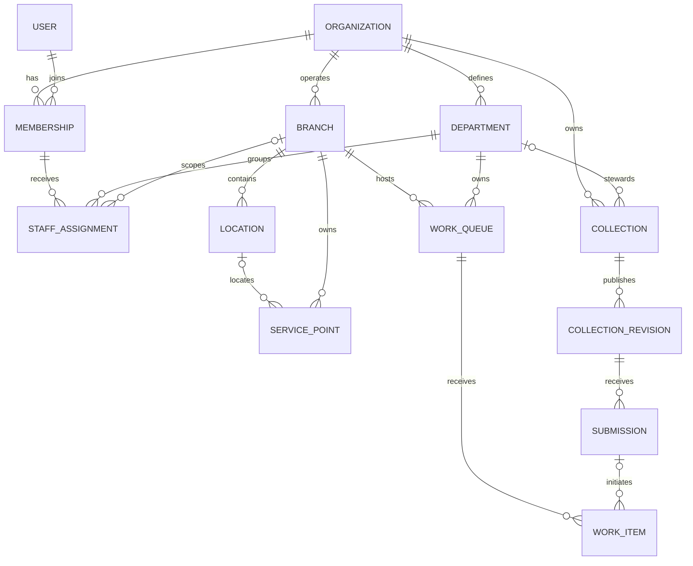
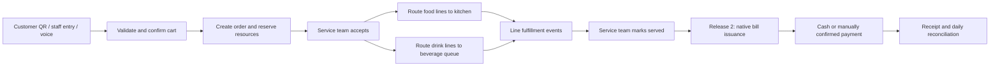
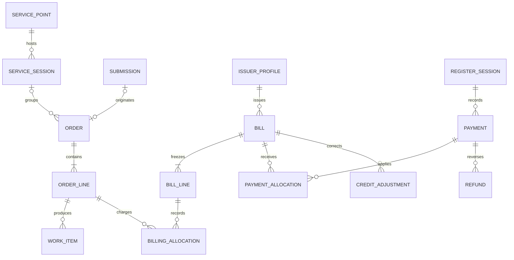

# Unified Collection Platform — Refined Product and Architecture Plan

Updated: 23 October 2026. Status: proposed design; features below are not implemented by this document.

Precedence update, 24 October 2026: [Universal Platform Architecture v3](universal-platform-architecture-v3.md) is the primary plan. The ordering/billing requirements here describe optional capabilities; the cafe-first stage table is historical and does not impose branches, departments, or orders on generic collections. Current progress and remaining dependencies are tracked in [implementation status](implementation-status.md).

## 1. Decisions and product position

Build a reusable collection and workflow foundation. Sell a complete cafe workflow first, rather than asking cafes to buy an abstract universal data platform.

The initial customer-facing proposition is: **take orders, send each item to the right team, track fulfillment, and subsequently generate and settle bills without entering the order twice.** Local operation and English/Hindi assisted capture support this outcome.

Decisions confirmed with the owner:

- Ordering is release 1. Our own billing is release 2, using the same order records; billing is not delegated to another POS.
- Initial prospects include cafes with basic/manual processes and cafes already using POS software.
- Multiple cafes use independent installations on their own computers and Wi-Fi. Initial customer access is LAN-only.
- English/Hindi voice capture remains part of the ordering release. Normal touch input always works without AI.
- Customer profile facts/files remain on customer devices. Only explicitly submitted values reach the organization. A website comes before a mobile app; backups are user-managed.
- Templates and collection capabilities are reusable across organizations. Live records and identities do not automatically synchronize between independent installations.

### What changes from the earlier plan

1. Add departments, branch context, service points, and operational queues as distinct concepts.
2. Separate captured submissions from operational orders, fulfillment tasks, and financial documents.
3. Route individual order lines to teams; do not assign an entire mixed order to one department.
4. Design native billing now, but implement and validate it after ordering. Existing payment-state strings do not constitute a billing ledger.
5. Do not automatically return prepared/cancelled food to sellable stock.
6. Keep the platform reusable without building a full ERP, payroll system, or general workflow programming language.

### Current repository evidence

At the original inspection, organizations, memberships, groups, forms, submissions, catalogs, and item-selection snapshots already existed. The later versioned-capture implementation adds collection/response revisions, receipts, and response limits. Update, 26 October 2026: flat optional departments, membership-based staff assignments and collection stewardship are implemented under People, with archive/restore and independent data authorization. Branch entities, workflow queues, invoice records, and payment-allocation records remain absent.

The current catalog calculation uses one catalog-level tax rate and calculates tax before discount. Preserve historical values, but do not reuse this calculation unchanged as the new billing policy. Historical amounts must not be silently recalculated.

No application code or database schema was changed for this refinement. The previous session's test results are historical, not a current test run.

## 2. Real-world entity model

Avoid a single hierarchy such as organization → department → form → everything. Businesses contain several overlapping relationships.

| Concept | Meaning | Cafe example | Other business example |
|---|---|---|---|
| Organization | Data owner and tenant | Cafe business | IT company |
| Branch | Operating site within an organization | Outlet A | Pune office |
| Department | Functional responsibility | Food preparation, service, accounts | Sales, development, HR |
| Membership | An account's relationship with an organization | Employee | Engineer |
| Assignment | Membership's department and optional branch scope | Kitchen operator at Outlet A | Sales lead at Pune office |
| Role/grant | Actions permitted in a resource scope | Prepare assigned items; issue bills | Approve a purchase request |
| Location | Physical area within a branch | Ground floor, kitchen room | Office floor, meeting room |
| Service point | Place where a service interaction occurs | Table 8, pickup counter | Reception desk, kiosk |
| Work queue | Where a team receives actionable work | Hot kitchen queue; beverage queue | Support queue; sales qualification queue |
| Collection | Versioned definition of required input | Order capture; feedback | Lead intake; leave request |
| Submission | Information received using that definition | A customer's submitted cart | A submitted request |
| Domain record | Typed business object created/updated through a command | Order | Future lead or service request |
| Work item | Action assigned to a queue/person | Prepare two coffees | Review a request |
| Resource | Capacity or quantity governed by rules | Bottles available | Seats or equipment |
| Commercial document | Issued financial record | Bill/invoice; credit adjustment | Future service invoice |
| Party | Customer/supplier identity when needed | Optional invoice customer | Business customer |
| User | Authenticated account | Cashier login | Employee login |

A table is not a department. A kitchen can name a department, physical room, and work queue; those records have different responsibilities even when their display names match. A department can span branches, and a person can serve more than one department.

Small cafes need a quick setup: one default branch, an optional combined service/cashier role, kitchen queue, and beverage queue. Do not require departments for a public survey. Do not create a separate database or application for each department.

### Relationship diagram

An optional steward department means responsibility for maintaining a collection, not exclusive access. Collections can serve several departments through explicit grants and routing. Department hierarchy, if added later, must not automatically inherit permissions; v1 uses flat departments.

### Why the engine needs typed modules

Shared core: schema revisions, reusable fields, submissions, validation, consent, access, audit, limits, and input adapters.

Reusable operations: queues, assignments, work-item events, and resource movements.

Domain capabilities: cafe ordering, fulfillment, and native billing. A survey enables response quotas without creating orders, kitchen tasks, or invoices. A future IT request can reuse capture and queues without inheriting restaurant states.

Composition keeps the foundation unified. Typed domain modules keep money, stock, and fulfillment correct. Neither an inheritance tree of form subclasses nor arbitrary JSON is an adequate model for the whole business.

## 3. Ordering, departments, and access

### Reference journey

Release 1 ends with fulfillment, operational summaries, and an order summary explicitly distinguished from a financial bill. Billing in release 2 uses existing orders directly.

- Model an operational order separately from its source submission. A source submission is optional for future imports, but QR and staff collection flows use the shared capture service.
- Give every order a branch. A dine-in service session links one active table visit to multiple orders; a takeaway order does not require a table.
- A static table QR identifies a service point, not authority to inspect every order ever associated with that table. Private receipt tokens reveal only their permitted orders.
- A service session is opened/closed by staff. New table submissions require an active session and remain pending staff acceptance; LAN reachability is not a guarantee of presence.
- Map menu categories/items to branch-local queues. Snapshot the destination at acceptance. Unmapped lines enter a visible service-review queue and cannot silently disappear.
- Create fulfillment work items per order line. Kitchen sees food and preparation notes; beverage staff see drinks; neither needs the customer's profile vault or payment history.
- Keep order acceptance, per-line fulfillment, billing, and payment states independent. Derive overall readiness from all required uncancelled line tasks.
- Use versioned transition commands and idempotency keys to prevent two staff actions from fulfilling or cancelling the same quantity twice.
- Reserve finite stock on successful submission. Pending reservations expire after ten minutes. Acceptance retains the allocation; starting preparation consumes it. Before preparation, cancellation releases the allocation once. After preparation starts, cancellation records waste/consumption; a manager may separately authorize a reasoned stock adjustment.
- Expiry and stock release must commit as state transitions, not just disappear from a filtered screen. Use a scheduled local cleanup command, and expire stale reservations in the transactional availability path before allocating stock.

### Permission policy

An organization administrator can configure the business. Other permissions require an action grant with organization, optional branch, and resource/queue scope. Department assignment alone grants no unrestricted data access.

| Role template | Default allowed actions | Exclusions |
|---|---|---|
| Kitchen operator | View assigned food tasks, start/finish preparation | Bills, customer files, full response exports |
| Beverage operator | View and process beverage tasks | Kitchen-only tasks and finance |
| Service operator | Accept orders, manage service sessions, mark served | Issue refunds or change financial settings |
| Cashier, release 2 | View billable order lines, issue bills, record tenders | Rewrite issued bills or change tax policy |
| Branch manager | Manage local routing/stock and approved exceptions | Other branch data without a grant |
| Organization administrator | Manage organization configuration and grants | Customer device vault access |
| Collection editor | Maintain explicitly granted collection definitions | Automatic access to submitted results |
| Survey respondent | Submit to the permitted collection | Other responses and workspaces |

Implementation update: organization groups have been migrated into distinct departments; restricted-form access is granted explicitly to selected departments. Revoking membership/assignment must affect requests immediately. Permission filters apply to APIs, exports, files, analytics, and AI retrieval, including field-limited operational projections.

## 4. Native billing design — release 2

Billing is an owned product module. It must not require re-entry of orders into a third-party billing system. Prospects already using a POS can test ordering while retaining their existing financial process, but we must not market that ordering pilot as completed billing replacement.

### First billing release

- Open a bill from eligible accepted order lines, including multiple orders in one service session. Show served/in-progress quantities and require a manager-approved exception for unserved items. Do not include rejected/cancelled quantities.
- Finalize one bill per service session, or one bill per takeaway order. Split invoices, table transfers/merges, and post-issuance additions are later features; additional orders after issuance start a new session.
- Freeze new orders to that session while finalizing, and enforce one-time billing allocation per quantity. Prevent concurrent finalizations from billing the same lines twice.
- Snapshot issuer identity, customer details only when required, item descriptions, quantities, unit prices, discounts, tax components, currency, rounding policy, and calculation version.
- Use Decimal arithmetic and configurable validated tax/discount policies. Do not hardcode every cafe to the current catalog-wide tax-before-discount calculation.
- Assign document numbers atomically within the issuer/series/financial-year scope. Preserve issued documents; corrections use linked adjustments rather than editing or deleting history.
- Offer printable browser/PDF receipts and one explicitly supported thermal-printer setup after hardware testing. Generic direct printing to every printer is not promised.
- Record cash and manually confirmed UPI/card tenders, including partial and mixed-method payments, cashier identity, time, and reference. Manual confirmation is distinguishable from provider verification.
- A QR displayed for payment or a customer screenshot never automatically marks a bill paid. Gateway verification and webhooks are a subsequent integration.
- Track cashier register sessions, opening float, cash received/refunded, closing count, and variance. Reports distinguish billed value, payments received, receivables, and corrections.
- Require manager authorization and a reason for corrections/refunds. A credit adjustment changes the amount owed; a refund records money returned. Neither automatically reverses stock consumption.
- Validate the pilot issuer's document type and current Indian tax requirements before using this release for statutory invoices. Unsupported mandatory e-invoicing requirements block financial go-live for that issuer, rather than producing a misleading invoice.

### Commercial ER diagram

Constraints limit a source submission to at most one created order in the new cafe flow and cap allocations at the billable quantities. Draft bills are editable; issued bills are immutable. Historical item selections retain existing identifiers and totals; explicitly bridge them to new order records without treating old payment strings as verified receipts.

An issuer profile is not simply a department or a branch name. It supplies the financial identity for the bill. The first release supports one configured issuer per cafe installation; multi-issuer financial consolidation is deferred.

## 5. Engineering approach and implementation order

Retain the Django monolith and existing template/JavaScript approach. Keep organizations/memberships and existing public form URLs stable. Use the existing SQLite deployment initially; contention and transaction tests must pass on the real engine.

Module boundaries:

- `organizations`: departments, branches, assignments, locations, service points, and scoped access.
- `forms`: collection revisions, submissions, catalogs, reusable field and capability contracts.
- New `operations`: queues, routing rules, work items, events, and resources.
- New `orders`: service sessions, orders, and order lines; compatibility bridge from current item selections.
- New `billing`, release 2: issuer settings, bill documents, allocations, tenders, register sessions, corrections, and refunds.
- Existing `ai_gateway`: local speech/interpretation adapters and optional configured cloud inference. AI does not issue bills, confirm payment, or authorize transitions.

Keep command-side cross-module work in explicit transaction services, rather than signal chains. All operational writes carry organization/branch scope, actor, idempotency key, and expected record version where relevant. Idempotency keys are unique within their operation scope; reusing a key with a different payload is rejected.

Add department/branch administration under existing organization APIs. Preserve `/api/forms/` and public form links. Introduce `/api/orders/` for order commands, `/api/operations/` for scoped tasks, and later `/api/billing/` for financial commands. Writes are server-validated action endpoints, not arbitrary client mutation of status columns.

| Stage | Deliverable | Exit condition |
|---|---|---|
| A. Customer discovery and domain validation | Observe actual work; catalogue departments, queues, devices, billing needs | At least three plausible pilot cafes and one repeated costly problem |
| B. Organization and collection foundation | Default branch; departments/assignments; independent permissions; revisions | Safe migration, preserved public URLs, authorization tests pass |
| C. Ordering release | QR/staff entry, English/Hindi voice, queues, stock, receipts/status, optional wallet | Whole workflow works across food and beverage teams without AI dependency |
| D. Three-cafe pilot | Independent local installations; measured failures, task times, support burden | Demonstrated repeated use and willingness to pay |
| E. Native billing release | Issue bills from those orders, tenders, corrections, printing, reconciliation | Calculation, audit, issuer requirements, hardware, and closing tests pass |
| F. Controlled expansion | Feedback survey and one internal request template; later internet access | Same core reused without adding restaurant requirements to generic collections |

Each installation initially hosts one active branch. Shared organization-wide dashboards across separately hosted sites require explicit federation/synchronization later; the branch model alone does not create that capability.

Keep earlier device-wallet consent and encrypted backup requirements. Wallet use is optional, not an onboarding requirement for ordering. A standalone wallet origin and trusted HTTPS are still needed for browser isolation and microphone permissions. Preserve LAN-only operation, private uploads, trusted TLS, local backups, and restore instructions. Internet-down operation differs from server-down operation: no order is acknowledged until its server commit succeeds.

This refinement does not install REA or claim competitor runtime inspection. Public documentation informs the model; later targeted REA/browser investigation can verify a specific observable behavior. Do not install unrelated tools merely to claim additional expertise.

## 6. Market assessment and validation

### What current evidence establishes

| Evidence checked | Finding | Implication |
|---|---|---|
| [Petpooja pricing/features](https://www.petpooja.com/poss/pricing) | Billing, inventory, user rights, kitchen display, and QR ordering are offered | These capabilities are established competition, not a new category |
| [Odoo preparation documentation](https://www.odoo.com/documentation/19.0/applications/sales/point_of_sale/preparation.html) | Preparation destinations can filter product categories and use stages | Route line-level work to queues rather than treating departments as form folders |
| [Zoho Creator approvals](https://www.zoho.com/creator/approval-workflow/) | Role/hierarchy-based approval workflows already connect forms and actions | Cross-department collection/workflow is also an existing market |
| [Loyverse pricing](https://loyverse.com/en-us/pricing) | A free core POS exists alongside paid capabilities | Cheaper billing alone is insufficient positioning |
| [Restroworks POS](https://www.restroworks.com/restaurant-pos-system/) | A broad restaurant operations suite addresses established businesses | Do not start by matching a mature chain-management suite |
| [CBIC Rule 46](https://taxinformation.cbic.gov.in/content-page/explore-rules/1000136/1000001) | Tax invoices have prescribed information and numbering requirements | Billing needs an issuer-specific release gate; it is not a printable form template |

These sources demonstrate competing supply and recognizable workflows. They do not establish our target customers' dissatisfaction, switching willingness, market share, or willingness to pay. No customer interviews or competitor-account runtime tests were conducted in this refinement.

### Recommended initial segment

Independent dine-in cafes with roughly one to three outlets, a small staff, and meaningful friction between taking orders, preparing items, and producing the bill. Prioritize the cafes where our observed benefit is strongest, not the widest possible market.

For cafes using basic/manual systems, the eventual full journey can replace duplicate entry. For established POS users, switching cost is higher: invoices, printers, staff habits, integrations, historic records, and support all matter. Do not promise aggregator integrations or data migration before proving them. Their ordering pilot tests workflow value; production billing replacement is a separate acceptance decision.

### Demand experiment

1. Interview 12 owners/managers: six using manual/basic systems and six established-POS users. Observe four real service periods. Obtain permission before collecting workflow or commercial records.
2. Record real task time, wrong/missed orders, duplicate entry, current total software/support cost, printer/network constraints, and staff training needs. Ask for examples, not approval of our idea.
3. Ask prospects to rank local operation, queue coordination, voice capture, privacy, billing, and total cost. Do not assume every buyer values privacy or wants to manage a server.
4. Recruit three pilot cafes. First validate one installation, then repeat the same release at the remaining sites.
5. Run the ordering pilot for two weeks after setup. Target at least 100 real orders per cafe, 90% completion without rescue, and 30% less measured staff order-entry time than baseline. Treat these as proposed gates, not claimed outcomes.
6. Seek at least two explicit paid continuations for the demonstrated ordering product; separately record commitment to trial native billing. Free pilot participation is not evidence of revenue.
7. Record monthly support time and installation effort per outlet. Test pricing only after measuring value and costs. The previous ₹999/month suggestion remains an unvalidated experiment, not a finalized business model.

Sustainable contribution = outlet revenue minus support labor, deployment/renewal cost, infrastructure, and acquisition cost. Cafe data ownership does not eliminate the cost of updates, TLS renewal, backups, device support, and hardware faults.

### Go/no-go interpretation

- Continue if cafes repeatedly use the workflow, save measured time, can be installed/supportably, and pay for it.
- Change the entry point if cafes want billing but do not value a separate ordering product; validate a narrow combined ordering/billing release before expanding the generic builder.
- Reduce emphasis on customer voice if real users prefer tapping and corrections erase time savings; keep it as assistance rather than forcing it.
- Reconsider the local-server offer if deployment burden exceeds the value buyers perceive. Hosted deployment may be a later option, not an assumed rejection of the local-first goal.
- Do not expand into IT, healthcare, payroll, or full ERP simply because they also collect information. Prove reuse with a feedback survey and a small internal request workflow first.

## 7. Acceptance tests and release gates

- One organization with two branches: assignments and permissions do not leak between branches; departments can exist across both.
- One person works kitchen and service; an unrelated department member cannot see finance or customer documents.
- A mixed order routes food and drinks separately; one completed queue cannot falsely mark the other ready.
- Missing routing becomes a visible exception. A changed routing rule does not silently relocate accepted work.
- Repeated submissions, staff clicks, expiry workers, and restarts do not duplicate orders, tasks, reservations, or movements.
- Last-item competition, partial cancellation, pending expiry, and cancellation after preparation preserve inventory invariants.
- Department deletion/archive does not orphan active queues or erase historical responsibility. Reject archive until active work is explicitly reassigned; retain immutable historical labels/IDs.
- Collection revisions preserve historic responses. A 100-response survey remains capped under concurrency without creating domain orders.
- English/Hindi/mixed speech uses actual menu names and noisy recordings. AI failure and microphone denial leave usable touch ordering.
- Customer receipt tokens do not reveal another customer/table's history. Wallet denial leaves the order flow usable; disclosure sends only approved facts.
- Billing: one-time bill allocation; concurrent issuance; line/discount/tax/rounding fixtures; price changes after ordering; issuer changes after issuance; partial/mixed tenders; credit versus cash refund; daily closing and variance.
- A spoofed UPI screenshot does not verify payment. Issued financial documents cannot be rewritten by changing catalog fields or form schemas.
- Backup/restore reconciles orders, work items, private files, stock movements, financial documents, and numbering. Restored data does not silently reuse already-issued document numbers.
- Real Android/iPhone browsers, trusted TLS, cafe Wi-Fi, network loss, and target printers are verified before the corresponding feature is advertised.

Success is a reliable cafe workflow with credible paid demand, supported by a reusable foundation. A broader universal platform is the expansion path, not an assumption that every industry will buy the same product.
