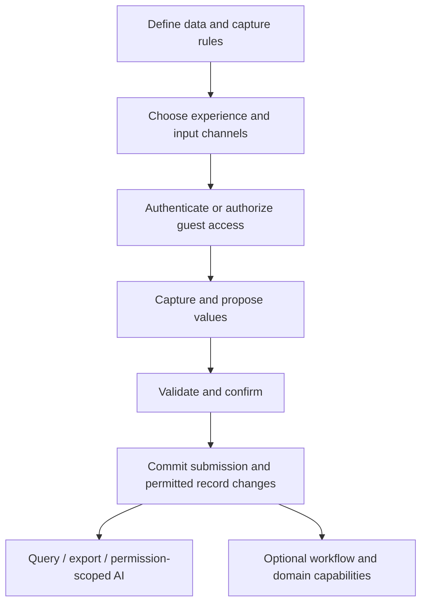
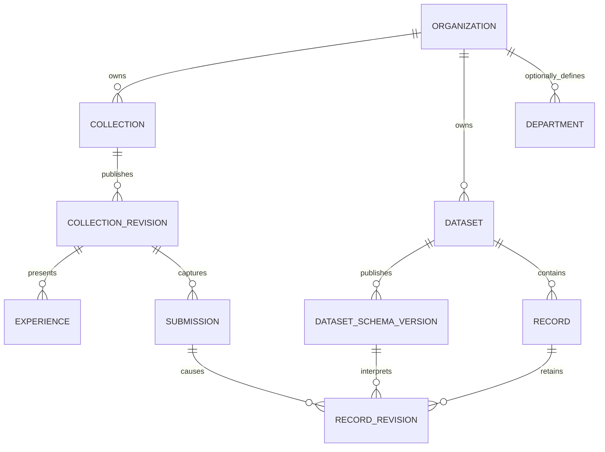

# Universal Data Collection Platform — Architecture v3

Updated: 23 October 2026. Target architecture; implementation progress is tracked separately below.

Implementation update, 25 October 2026: versioned collection/capture and reusable dataset foundations are implemented, including schema/record history, independent dataset grants, explicit collection mappings and the Data workspace. The complete reference workflows remain planned. See [implementation status](implementation-status.md) for the reconciled sequence and acceptance boundary.

Implementation update, 26 October 2026: optional departments, multi-department staff assignments and collection stewardship now have an admin UI under People. Assignments and stewardship do not automatically grant access; a restricted form can explicitly grant access to a department. Existing groups were converted to departments. Branches, scoped work queues and approval workflows remain planned.

Deployment and inference boundaries are refined in [Local and Cloud Architecture](local-cloud-architecture.md): one authoritative data home per workspace, optional cloud coordination, and task-specific AI routing.

Account model update (28 October 2026): personal and organization accounts are
separate choices at signup. An organization account has at most one organization
membership; a person uses separate accounts and email addresses for personal use
or additional organizations. The organization owner can transfer ownership to
another member. The earlier multi-organization account/switcher assumptions in
other design notes are superseded. Direct form ownership changes stay within one
organization; cross-organization form moves need a future explicit sharing flow.

## Product definition

A dynamic platform where people and organizations define what information they need, choose how it is collected, control who can contribute or use it, and apply optional workflows and business capabilities to the resulting records. AI assists setup, capture, normalization, and analysis across those interfaces.

The platform is the product. A cafe, event organizer, research team, and IT department are different configurations and acceptance scenarios, not separate foundational architectures. A specialized capability can need new code; universality means a stable extension model rather than every industry's rules already being implemented.

## Shared backbone

Separate these concepts:

| Concept | Owns |
|---|---|
| Organization/workspace | Ownership, membership, policies, and configuration |
| Department | Optional responsibility and scoped staff assignment |
| Dataset | Definition of reusable business data, such as assets, registrations, or catalog entries |
| Schema version | Stable field identifiers, types, required values, relationships, and validation |
| Collection | A configured way to obtain or update data, including its audience and explicit destination mapping |
| Experience | Presentation configuration: standard form, cards, guided chat, grid, or inspection checklist |
| Capture channel | Browser input, speech, barcode, file import, or authenticated API adapter |
| Submission | Version-linked captured input, actor/source metadata, and submission history |
| Record | A current business fact/entity stored in a dataset, with revisions for controlled updates |
| Capability | Optional server-side behavior: quota, inventory, approval, order handling, or billing |

A dataset is not the same as a form. Several collection experiences may update the same asset dataset; a single registration collection can read an event dataset and write a registrations dataset. Start with one explicit writable destination per collection to avoid ambiguous multi-dataset transactions. Readable lookup datasets remain independently permission checked.

Department, branch, location, billing, and ordering are optional. A simple survey can work without any of them. Do not derive permission from organization category or from a UI component being visible.

## Database strategy

### Separate deployment from table design

Use a standard relational structure in every installation. An organization hosting on its own computer has its own physical database. That database does not need differently named tables for its forms or departments. If an installation hosts multiple organizations, their records share those standard tables and are tenant scoped.

For the local prototype, retain SQLite and transactional application authorization. A future shared hosted deployment can use PostgreSQL with application authorization plus correctly configured row-level security as defense in depth. Database technology and hosting do not change the collection contracts. Browser storage in the customer's private wallet is a separate data boundary.

| Deployment pattern | Recommendation |
|---|---|
| Shared database, shared tables, organization ID | Default within an installation that hosts several organizations |
| Database per organization, same table definitions | Matches independent organization-hosted installations |
| Schema per organization | Possible isolation pattern, but not needed for this prototype |
| Dynamically created table per organization/form | Do not use as the default; increases migrations, naming, access, and reporting complexity |

These are tradeoffs, not one mandatory industry standard. Microsoft documents shared and isolated storage approaches: [multitenant storage architecture](https://learn.microsoft.com/en-us/azure/architecture/guide/multitenant/approaches/storage-data).

### Shared tables and flexible values

Keep ownership, identifiers, timestamps, status, schema references, and indexed relationships in normal columns. Keep organization-defined answer fields in a validated JSON value. Django supports [JSONField](https://docs.djangoproject.com/en/5.2/ref/models/fields/#jsonfield); storing JSON does not itself enforce the collection schema.

Conceptual tables:

- `organization`, `membership`, optional `department` and `staff_assignment`.
- `dataset`, `dataset_schema_version`, `record`, `record_revision`.
- `collection`, `collection_revision`, `experience`, `submission`, `submission_revision`.
- `attachment`, `access_grant`, `disclosure_receipt`, and `audit_event`.
- Typed capability tables when enabled: resources/movements, tasks/events, orders/lines, bills/lines, payments/allocations.

These are conceptual target names, not a demand to rename existing models. Current `DynamicForm.schema` and `FormSubmission.data` already demonstrate the schema-plus-answers pattern. Immutable versions, reusable datasets, and granular capability boundaries are additions.

### Example

One `collection` table can contain a cafe feedback collection and an IT equipment-request collection. One `submission` table can contain answers to both. Each row identifies its organization and collection revision; the answers differ in JSON structure and must validate against that revision.

For an IT request, `{"asset_type":"laptop","quantity":1}` is flexible input. An issued invoice, its tax totals, or a stock balance is a typed capability record with financial/quantity constraints. Do not put all invariant-bearing business data in unchecked JSON.

Use stable field IDs even when a label changes. Version published schema changes so historical data remains interpretable. Store attachment bytes in private file storage and metadata/references in relational tables. Do not embed uploaded identity files as JSON/base64 answer values.

Index organization, collection/dataset, and creation time for common scoped queries. Add field-specific indexes or typed projections for demonstrated reporting needs; do not create arbitrary indexes for every user-defined field. Avoid a pure entity-attribute-value model as the default because typing, joins, and reporting become harder.

### Isolation is more than filtering a screen

- Resolve authorized organization context on the server; do not trust an arbitrary organization ID in submitted data.
- Centralize query scoping and object authorization for reads, writes, uploads, exports, background jobs, and AI retrieval.
- Verify related objects belong to the same permitted tenant. A foreign key alone does not guarantee that a submission's organization matches its collection's organization.
- If organization ID is repeated on child rows for indexing/isolation, enforce consistency in write services and database constraints where supported.
- Collection access is additional to organization scope: submit, edit, view results, process tasks, and use individual fields are separate actions.
- Never join two people's records merely because names or email text match. Profile disclosure, authenticated identity, explicit record keys, and tenant policies govern reuse.
- Test tenant leaks directly. PostgreSQL [row-security policies](https://www.postgresql.org/docs/current/ddl-rowsecurity.html) can strengthen a hosted deployment, but must be configured with an appropriate non-bypass application role; they do not replace application permissions.

## Experiences, AI, and extensions

Presentations and inputs map to the same typed capture contract. A card picker and spoken request can both populate the same item-reference and quantity fields. QR opens a collection/context or supplies a validated lookup identifier; it is not proof of identity, location, or entitlement.

JSON Schema is suitable for structural validation, with application checks for permissions and business meaning. Use a documented supported subset and explicit schema dialect/version instead of claiming arbitrary schema support. Preserve existing form compatibility through an adapter. See [JSON Schema's structural/semantic distinction](https://json-schema.org/understanding-json-schema/about).

Capabilities expose their configuration, required data types, validation, authorized commands, and resulting events. Organization administrators select installed capabilities; trusted application code implements them. Do not execute arbitrary Python/JavaScript supplied through a form schema. Share versioned templates without user data, secrets, or access grants.

AI helps propose schemas, extract values from English/Hindi speech, map import columns, suggest permitted profile facts, detect possible duplicates, and query authorized records. AI outputs are proposals validated by the same services as manual inputs. Low-confidence or consequential changes require confirmation. AI has no unrestricted database access. Local inference is default; configured cloud use has explicit disclosure and no silent fallback.

## Prototype and adoption plan

Build the generic builder, schema/version handling, capture pipeline, scoped datasets, and data viewer first. Before calling the architecture universal, demonstrate these three workflows in the same release:

1. Public event registration or survey: standard fields, optional wallet reuse, and a 100-response quota.
2. Internal equipment request: member-only collection, asset lookup, and department approval.
3. Cafe order: item cards, English/Hindi voice, kitchen/beverage routing, and resource limits.

They must reuse capture, validation, access, records, and audit infrastructure. No restaurant tables, order statuses, branch requirement, or payment requirement may be introduced into the other scenarios.

Native billing follows ordering as previously agreed. It is a reusable commercial capability for supported products/services, not the platform's root entity. Initially verify it in cafes; do not claim that one tax configuration supports every industry or jurisdiction. The detailed native billing and department/queue requirements remain in [the operational module plan](product-architecture-v2.md).

Universal architecture and customer acquisition are different decisions. Cafes can remain an accessible pilot group while research also includes event/research teams and internal operations teams. Test whether people can configure a second collection without developer changes, whether capture is faster, whether private profile reuse is understood, and whether organizations pay for that benefit. Do not infer demand for the whole platform from cafe pilot adoption alone.

Broaden the competitive comparison: [ODK Entities](https://docs.getodk.org/entities-intro/) already supports reusable entities across collection workflows; [KoboToolbox](https://support.kobotoolbox.org/data-collection-tools.html) supports web and mobile collection, including offline methods; [SurveyJS](https://surveyjs.io/form-library/documentation/overview) supports JSON-defined forms against independent backends. These are relevant competitors/reference systems beyond restaurant POS. Their existence is evidence of established approaches, not proof that our proposed differentiation has demand.

Acceptance includes organization isolation, revision compatibility, all three reference workflows, equivalent manual/voice/API validation, failed-AI fallback, consent-limited wallet sharing, retry safety, response quotas, and backup/restore. The implementation update above covers the foundations only; it does not establish acceptance for the full target architecture.
